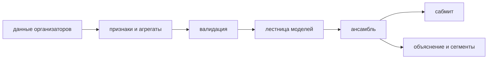

# <!-- Название решения --> · DATATHON'26

<!--
Шаблон README для сдачи. Заполняет скилл /ship после фриза; разделы не переставлять, все подсказки-комментарии удалить.
До старта это README команды: как работать с репо — docs/PLAYBOOK.md, правила агентов — AGENTS.md.
-->

> **До сдачи:** как работать с этим репозиторием вдвоём с AI-агентами — [docs/PLAYBOOK.md](docs/PLAYBOOK.md). Этот блок `/ship` заменит одной фразой о том, что решение даёт ForteBank.

## Задача
<!-- Что просил кейсодатель и как мы это поняли (2–4 предложения). ТЗ — docs/TASK.md. -->

## Результат
| | Метрика (<!-- из ТЗ -->) | Комментарий |
|---|---:|---|
| dummy (константа) | | точка отсчёта |
| бейзлайн | | первый прогон |
| **финальная модель** | | <!-- run_id, ± по фолдам --> |

Валидация: <!-- схема и почему она повторяет боевое использование (одна фраза) -->. Путь от бейзлайна к финалу — `docs/METRICS.md`, все эксперименты — `docs/EXPERIMENTS.md`.

## Главные инсайты
<!-- 3 пункта: утверждение + цифра + действие для банка. Подробно — docs/INSIGHTS.md. -->

## Как работает решение

<!-- 3–5 предложений: от входных данных до сабмита. Детали — docs/SOLUTION.md. -->

## Технологии
Python 3.12, uv, pandas, scikit-learn, LightGBM, CatBoost, XGBoost, Optuna, SHAP, matplotlib, FastAPI. <!-- поправить по факту -->

## Установка и запуск
```bash
uv sync                                    # Python 3.12 и библиотеки (macOS: brew install libomp)
# положить файлы организаторов в data/raw/ (в репозиторий не входят — см. «Данные»)
uv run python -m app.cli auto              # обучение, ансамбль, сабмит, отчёт → runs/<run_id>/
```

## Как проверить решение
```bash
uv run python -m app.cli runs              # → лидерборд прогонов, финальный: <!-- run_id, метрика -->
cat runs/<!-- run_id -->/report.md         # → лидерборд моделей, решения агента, важность признаков
uv run uvicorn app.main:app --port 8000    # → http://localhost:8000: прогоны, графики; POST /api/predict
uv run pytest -q                           # → автотесты
```
<!-- вход → ожидаемый выход; где лежит сабмит -->

## Данные
<!-- Что дали организаторы (файлы, период, объём). Сырые данные в git не входят (конфиденциальны); код воспроизводит всё из data/raw/. -->

## Ограничения
<!-- честно: что не проверено, где модель может ошибаться -->

## Команда
<!-- имена, роли, GitHub -->

## Как мы работали с AI-агентами
<!-- два агента (Claude Code / Codex) с общими правилами (AGENTS.md), зонами и каналом сообщений; оркестратор app.cli auto пишет журнал решений -->

## Заранее подготовленное, заимствования и AI-инструменты
См. `docs/PREPARED.md`.
