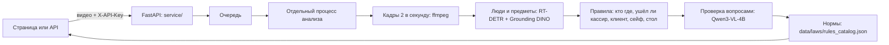

# Проверка кассовой дисциплины по видео · DATATHON'26 × ForteBank

Локальный AI-сервис: загружаете видео с камеры над кассой (`.mov` или `.mp4`) → получаете вердикт, тип нарушения, таймкод, 1–3 кадра-доказательства, описание и пункт нормы НБРК. Все модели работают на самом сервере, внешние AI API не используются.

ТЗ: [docs/TASK.md](docs/TASK.md) · контракт API: [docs/REQUIREMENTS.md](docs/REQUIREMENTS.md) · типы нарушений: [docs/VIOLATIONS.md](docs/VIOLATIONS.md) · нормы: [docs/LAWS.md](docs/LAWS.md)

## Адрес сервиса

**https://kassa.unisprint.win** — веб-страница и API с одного адреса. API-ключ команда передаёт жюри лично (в репозитории его нет).

Видео обрабатываются по очереди: загружайте по одному и дожидайтесь результата — каждое занимает 1–3 минуты.

## Результат

Проверка как у жюри: все 40 обучающих видео загружены через API в работающий сервис, реальная модель, без кэша, по одному (`runs/jury/20261018T0516-374b`).

| Метрика | Значение |
|---|---|
| Верный вердикт | **39 из 40 (97,5 %)** |
| Ложные тревоги на чистых видео | **0 из 19** |
| Найдено видео с нарушением | 20 из 21 |
| Тип назван верно | 21 из 22 событий |
| Время обработки одного видео | 37–152 с (лимит ТЗ — 300 с), сбоев 0 |

Правила подбирались на этих же 40 видео, поэтому это не независимый тест. Каждое правило принималось, только если находит свой случай и не даёт ни одной ложной тревоги на 19 чистых видео. Подробно — [docs/METRICS.md](docs/METRICS.md), ограничения — [docs/SUBMISSION.md](docs/SUBMISSION.md#6-ограничения-решения-и-известные-случаи-ошибок).

## Как работает



| Модель | Для чего | Лицензия |
|---|---|---|
| RT-DETRv2-R50 (`PekingU/rtdetr_v2_r50vd`) | люди, сумки, стаканы | Apache-2.0 |
| Grounding DINO tiny (`IDEA-Research/grounding-dino-tiny`) | стол, ноутбук, сейф, дверь, счётная машина | Apache-2.0 |
| Qwen3-VL-4B-Instruct, 4-bit MLX (`mlx-community/Qwen3-VL-4B-Instruct-4bit`) | вопросы «да/нет» по вырезкам кадров | Apache-2.0 |

## Где что работает

| Компьютер | Режим | Нужны модели |
|---|---|---|
| **macOS на Apple Silicon (M1–M4), от 16 ГБ памяти** | `real` — полное распознавание | да, ~8 ГБ |
| Linux или Windows | `mock` — проверка API и страницы, вердикт тестовый | нет |

Qwen запускается через MLX, а MLX работает только на Mac с Apple Silicon. Версия на Linux с видеокартой NVIDIA — план, не реализована (нужна замена слоя `vision/vlm.py` на PyTorch).

## Установка

Модели **не хранятся в git**: они лежат в папке `models` **рядом с репозиторием** (`../models`). Путь можно поменять настройкой `MODELS_DIR` (см. «Настройки»).

```
хакатон-дататон/
├── datathon26/   ← этот репозиторий
└── models/       ← веса моделей (~8 ГБ), создаёт scripts/download_models.sh
```

### macOS и Linux

```bash
# 1. Программы
# macOS:
brew install git uv ffmpeg hf cloudflared libomp
# Linux (Ubuntu/Debian):
sudo apt update && sudo apt install -y git ffmpeg curl
curl -LsSf https://astral.sh/uv/install.sh | sh        # затем откройте новый терминал
uv tool install "huggingface_hub[cli]"                 # команда hf для скачивания моделей

# 2. Код и Python-зависимости
git clone https://github.com/DanialMyrzatayevMuratovich/datathon26.git
cd datathon26
uv sync --frozen

# 3. Модели → ../models (~8 ГБ; нужно только для real-режима на Mac)
bash scripts/download_models.sh

# 4. Ключ доступа: создаёт .env.local со случайным API_KEY (файл не попадает в git)
uv run python -m service.cli init

# 5. Запуск
# Mac Apple Silicon, настоящая модель:
VISION_ENGINE=real SERVICE_WORKERS=1 bash scripts/run_service.sh
# Linux (тестовый режим без модели):
bash scripts/run_service.sh
```

Страница: <http://127.0.0.1:8000/> · проверка: <http://127.0.0.1:8000/api/v1/health> · остановка: Ctrl+C.

### Windows

Команды установки — в **PowerShell**, всё остальное — в **Git Bash** (ставится вместе с Git).

```powershell
# 1. Программы (PowerShell), затем закройте и откройте терминал заново
winget install --id Git.Git -e
winget install --id astral-sh.uv -e
winget install --id Gyan.FFmpeg -e
winget install --id Cloudflare.cloudflared -e          # для публичного адреса, по желанию
uv tool install "huggingface_hub[cli]"                 # команда hf, если хотите скачать модели заранее
```

```bash
# 2. Код и запуск (Git Bash)
git clone https://github.com/DanialMyrzatayevMuratovich/datathon26.git
cd datathon26
uv sync --frozen
uv run python -m service.cli init
bash scripts/run_service.sh                            # тестовый режим mock
```

На Windows работает режим `mock` (API и страница). Модели скачивать не обязательно: настоящая модель запускается только на Mac.

## Настройки (`.env.local`)

Файл создаёт `service.cli init`; он в `.gitignore`, у каждого свой. Менять — обычным редактором.

| Переменная | По умолчанию | Что делает |
|---|---|---|
| `API_KEY` | создаётся случайно | Ключ доступа к API (заголовок `X-API-Key`). Чтобы сменить — впишите свой; `init` существующий ключ не перезаписывает |
| `MODELS_DIR` | `../models` | **Путь к папке с моделями.** Если положили модели в другое место — укажите абсолютный путь |
| `VISION_ENGINE` | `mock` | `real` — настоящая модель (только Mac Apple Silicon) |
| `SERVICE_WORKERS` | `2` | Сколько видео обрабатывать одновременно. **На Mac с 16 ГБ ставьте `1`**: два процесса уходят в подкачку |
| `SERVICE_CAPACITY` | `8` | Максимум видео в загрузке, очереди и обработке вместе |
| `SERVICE_TIMEOUT_SEC` | `270` | Лимит на одно видео (очередь + обработка) |
| `SERVICE_RETENTION_SEC` | `86400` | Сколько хранить результаты (24 ч) |

Скрипт `scripts/download_models.sh` тоже понимает `MODELS_DIR`: `MODELS_DIR=/путь/к/models bash scripts/download_models.sh`.

## Публичный адрес

Сервис слушает только `127.0.0.1:8000`; в интернет его выводит туннель Cloudflare (`cloudflared`).

**Постоянный адрес на своём домене** (так работает `kassa.unisprint.win`; домен должен быть в вашем аккаунте Cloudflare):

```bash
cloudflared tunnel login                                  # в браузере выбрать домен → Authorize
cloudflared tunnel create forte
cloudflared tunnel route dns forte kassa.ваш-домен.com
# ~/.cloudflared/config.yml:
#   tunnel: <id туннеля>
#   credentials-file: ~/.cloudflared/<id туннеля>.json
#   ingress:
#     - hostname: kassa.ваш-домен.com
#       service: http://127.0.0.1:8000
#     - service: http://127.0.0.1:8000
TUNNEL_NAME=forte bash scripts/tunnel.sh
```

**Временный адрес без аккаунта:** `bash scripts/tunnel.sh` — выдаст `https://…trycloudflare.com`; он меняется при каждом перезапуске туннеля.

Пока идёт проверка, компьютер должен быть включён, не спать и быть в сети (скрипт запуска держит Mac бодрствующим через `caffeinate`).

## Как проверить

```bash
uv run ruff check . && uv run pytest -q                   # код и тесты
uv run python -m service.smoke                            # API на 5 синтетических видео (mock)
uv run python -m vision.evaluate                          # оценка на 40 видео (Mac, нужны видео в data/raw/)
uv run python -m vision.experiments.jury_check            # как у жюри: все видео через запущенный API
```

Пример запроса к API (ключ вводится скрыто):

```bash
read -rsp 'API key: ' API_KEY; echo; export API_KEY
curl -sS -H "X-API-Key: $API_KEY" -F 'file=@video.mov' https://kassa.unisprint.win/api/v1/analyze
curl -sS -H "X-API-Key: $API_KEY" https://kassa.unisprint.win/api/v1/jobs/JOB_ID
```

| Метод | Ответ |
|---|---|
| `POST /api/v1/analyze` | `{"job_id": "…"}`; одно поле `file`, `.mov` или `.mp4` до 200 МБ |
| `GET /api/v1/jobs/{id}` | `processing` / `failed` / `done` + `verdict`, `violations` (схема — `contract/schemas.py`) |
| `GET /api/v1/jobs/{id}/details` | прогресс, стадия, ошибка, анализ с нормами (для страницы) |
| `GET /api/v1/jobs/{id}/video` | исходное видео |
| `GET /api/v1/health` | `{"ok": true, "engine": "real"}` — без ключа |

Ошибки: `400` формат или пустой файл, `401` ключ, `404` нет задачи, `413` больше 200 МБ, `429` очередь заполнена, `503` проблема сервера.

## Данные и ограничения

- Видео организаторов лежат в `data/raw/`, загрузки сервиса — в `runs/jobs/`; оба пути исключены из git. Веса моделей — вне репозитория (`../models`).
- Пропускаем T13 «деньги приняты без удостоверения» (Х-2): удостоверение на этом разрешении неотличимо от купюр. Правила T3 (ключ в замке), T6 (дверь) и T9 (нет пересчёта руками после машины) подобраны на 1–4 видео и могут ошибаться на другой камере.
- Видео обрабатываются по одному (на Mac с 16 ГБ): если загрузить сразу много длинных видео, последние могут не уложиться в лимит.
- Результат — подсказка проверяющему, решение о нарушении принимает человек.

## Команда

| Участник | Роль |
|---|---|
| **Даниал** | лид команды, ML: распознавание, правила, нормы, оценка качества |
| **Асылбек** | API и бэкенд, очередь, надёжность, запуск и деплой |
| **Бигали** | веб-интерфейс, документы для сдачи |
| **Искандер** | сбор и фильтрация данных, проверка видео и разметки, метрики, презентация и защита |

Как мы работали с AI-агентами: [AGENTS.md](AGENTS.md); что подготовлено заранее и заимствования: [docs/PREPARED.md](docs/PREPARED.md).
