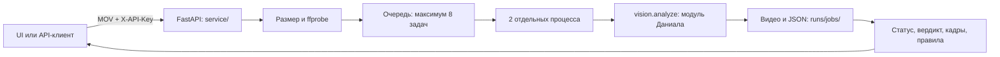

# Проверка кассовых видео · DATATHON'26

Локальный анализ видео для ForteBank: MOV → вердикт → возможные нарушения с таймкодами, кадрами и нормативными основаниями. ТЗ: [docs/TASK.md](docs/TASK.md), контракт: [docs/REQUIREMENTS.md](docs/REQUIREMENTS.md).

## Задача

Найти признаки возможных нарушений кассовой дисциплины по записи камеры над кассой. Проверяющий получает результат через API и самостоятельно проверяет кадры и ссылки на правила. Обработка выполняется на компьютере команды, без облачных AI-сервисов.

## Результат

Реализован API загрузки и результатов, ограниченная очередь, отдельные процессы обработки, ключ доступа, сохранение задач и удаление старых результатов. По умолчанию включён **`VISION_ENGINE=mock`**: это проверка интеграции, её вердикты не являются результатами распознавания. Качество реальной модели публикует danial после оценки; см. [docs/ML_SPEC.md](docs/ML_SPEC.md).

Публичный URL сдачи пока не зафиксирован. Его назначают после запуска на основном хосте и проверки через мобильный интернет. API-ключ передаётся жюри лично.

## Главные инсайты

Типы нарушений и нормативные основания: [docs/VIOLATIONS.md](docs/VIOLATIONS.md) и [docs/LAWS.md](docs/LAWS.md). Выводы о качестве модели требуют отдельной оценки на размеченных видео.

## Как работает решение



Загрузка возвращает `job_id`, обработка идёт в фоне. Клиент опрашивает статус; публичный ответ соответствует `contract/schemas.py`, дополнительные поля для UI доступны отдельно. Таймаут от постановки в очередь — 270 секунд, затем процесс останавливается и задача получает `failed`. Завершённые результаты сохраняются при перезапуске; прерванные задачи получают `failed` с объяснением. Срок хранения — 24 часа.

## Технологии

Python 3.12, FastAPI, Pydantic, python-multipart, Uvicorn, FFmpeg/ffprobe, uv; туннель — cloudflared. Каталог норм: `data/laws/rules_catalog.json`. Модуль распознавания принадлежит danial, интерфейс `ui/` — bigali. Старый табличный набор `app/` не является API этого кейса.

## Установка и запуск

Нужны Git, uv и FFmpeg (`ffmpeg` и `ffprobe` в PATH). На Windows `.sh` запускаются в **Git Bash**. FFmpeg: `winget install --id Gyan.FFmpeg -e` на Windows; `brew install ffmpeg libomp` на macOS. После установки на Windows откройте новый терминал.

Из корня репозитория:

```bash
uv sync --frozen
uv run python -m service.cli init
bash scripts/run_service.sh
```

**Временная зависимость:** пока danial не добавил `python-multipart` в `pyproject.toml` и `uv.lock`, после `uv sync` выполните `uv pip install python-multipart==0.0.32`. Это меняет только локальное окружение. После обновления lockfile дополнительная команда не нужна. Docker-сборка проверяет наличие зависимости и до обновления lockfile не завершится.

`init` создаёт случайный `API_KEY` в игнорируемом `.env.local`, не печатает и не заменяет существующий ключ. Страница: <http://127.0.0.1:8000/>; API: <http://127.0.0.1:8000/api/v1/health>. До появления `ui/index.html` главная страница возвращает 503, API работает. Остановка — Ctrl+C.

| Переменная в `.env.local` | По умолчанию | Назначение |
|---|---|---|
| `API_KEY` | обязательна | Общий ключ; не передавать в URL |
| `VISION_ENGINE` | `mock` | `real` включать после готовности модуля danial |
| `SERVICE_WORKERS` | `2` | Одновременные процессы анализа |
| `SERVICE_CAPACITY` | `8` | Максимум загрузок, ожидающих и работающих задач вместе |
| `SERVICE_TIMEOUT_SEC` | `270` | Очередь + обработка; максимум 270 секунд |
| `SERVICE_RETENTION_SEC` | `86400` | Срок хранения завершённых задач |
| `JOBS_DIR` | `runs/jobs` | Видео, результаты и журналы |

Uvicorn запускается с **одним** API-процессом: `uv run uvicorn service.main:app --host 127.0.0.1 --port 8000 --workers 1`. Параллельность анализа регулируется `SERVICE_WORKERS`. Блокировка каталога запрещает второму сервису использовать ту же очередь.

Для публичного адреса установите cloudflared (`winget install --id Cloudflare.cloudflared -e` / `brew install cloudflared`) и запустите `bash scripts/run_service.sh --tunnel`. HTTPS-адрес появится в выводе cloudflared. Quick Tunnel временный и меняется после перезапуска; перед сдачей нужен стабильный хост и согласованный URL. Для заранее настроенного named tunnel задайте `TUNNEL_NAME`.

Туннель передаёт HTTP-трафик через Cloudflare; для внутреннего контура банка используется прямой локальный доступ. AI-вычисления остаются на хосте. Основной хост — Mac Даниала, резервный — ноутбук Асылбека. На macOS скрипт включает `caffeinate`. На Windows на время длительной проверки подключите питание и отключите сон. Итоговый адрес проверьте с телефона через мобильную сеть.

Docker после обновления lockfile: `docker build -t forte-video .`, затем `docker run --rm -p 127.0.0.1:8000:8000 --env-file .env.local -v forte-jobs:/app/runs/jobs forte-video`. В образ входят API, FFmpeg, контракт, vision, доступный UI и каталог правил. Видео, ключи и веса не копируются. Веса подключаются отдельно по инструкции danial; совместимость MLX-движка с Linux-контейнером требует отдельной проверки.

## Как проверить решение

```bash
uv run ruff check . && uv run pytest -q
# Сервер должен работать в другом терминале:
uv run python -m service.cli check --synthetic --count 5 --report runs/jobs/smoke.json
uv run python -m service.cli check data/raw/open/videos/X-1.mov --count 1
```

Нагрузочная команда выводит job_id, статус, длительности, число нарушений/кадров и движок; ключ и кадры не печатает. Синтетическое видео проверяет API и очередь, а не точность распознавания.

Пример для Git Bash/macOS, ключ вводится скрыто и не записывается в историю:

```bash
read -rsp 'API key: ' API_KEY; echo; export API_KEY
curl -sS -H "X-API-Key: $API_KEY" -F 'file=@data/raw/open/videos/X-1.mov' http://127.0.0.1:8000/api/v1/analyze
curl -sS -H "X-API-Key: $API_KEY" http://127.0.0.1:8000/api/v1/jobs/JOB_ID
```

| Метод | Ответ |
|---|---|
| `POST /api/v1/analyze` | `200 {"job_id":"…"}`, одно multipart поле `file`, MOV до 200 MiB |
| `GET /api/v1/jobs/{id}` | `processing`/`failed`: только `job_id`, `status`; `done`: также `verdict`, `violations` |
| `GET /api/v1/jobs/{id}/details` | Прогресс 0…1, стадия, имя файла, ошибка, анализ с правилами |
| `GET /api/v1/jobs/{id}/video` | Оригинал; поддерживает Range и HEAD |
| `GET /api/v1/health` | `{"ok":true,"engine":"mock"}` или `real`, без ключа |

Все API кроме health требуют `X-API-Key`, включая details и video. Для плеера UI получает файл через `fetch` с заголовком и создаёт Blob URL. API возвращает `Cache-Control: no-store`.

Ошибки: `400` — поле/формат/пустой файл, `401` — ключ, `404` — задача отсутствует или истекла, `413` — превышен размер, `429` + `Retry-After: 5` — очередь заполнена, `503` — нет FFprobe. Неуспешный анализ получает `failed`; причина в `/details`, журнал — `runs/jobs/<id>/worker.log`.

## Данные

Конфиденциальные видео организаторов хранятся в `data/raw/`; загрузки API — в `runs/jobs/<id>/`. Сервис создаёт в каталоге задач `.gitignore` с правилом `*`, дополнительно нужна общая запись `runs/jobs/` от лида. Не используйте `git add -f` для данных. Docker также исключает их. Через 24 часа завершённые задачи удаляются вместе с видео; срок настраивается через `SERVICE_RETENTION_SEC`.

## Ограничения

- `mock` возвращает заданное тестовое нарушение с реальным кадром: его нельзя выдавать за вывод модели.
- Качество распознавания и скорость на полном видео оценивает danial. Пять синтетических видео не подтверждают скорость ML на 145-секундных роликах.
- Один хост и один API-процесс; после перезапуска незавершённые задачи нужно загрузить повторно.
- Общий ключ подходит для командного демо; пользовательских аккаунтов и разделения доступа нет.
- Локальный лимит — 200 MiB; публичный прокси может ограничивать размер сильнее. Проверьте итоговый маршрут на файлах размера жюри.
- `/health` подтверждает запуск API; готовность весов и реального движка проверяется полным прогоном с `VISION_ENGINE=real`.

## Команда

| Участник | Поток |
|---|---|
| Даниал (`danial`) | Лид, контракт, распознавание, нормы и оценка |
| Асылбек (`asylbek`) | API, очередь, надёжность, запуск и деплой |
| Bigali (`bigali`) | UI, сдача и презентация |

## Как мы работали с AI-агентами

Правила: [AGENTS.md](AGENTS.md), зоны: [docs/ZONES.md](docs/ZONES.md), задачи: `docs/tasks/`. Каждый агент работает в своей зоне. `bash scripts/sync.sh` получает изменения и показывает доску. `bash scripts/checkpoint.sh "сообщение"` проверяет секреты и зоны, запускает тесты, делает commit и push. При ручном контроле агент готовит изменения, команду запускает человек. Не включайте `autopush.sh` одновременно с ручным режимом.

## Заранее подготовленное, заимствования и AI-инструменты

См. [docs/PREPARED.md](docs/PREPARED.md). Табличный AutoML-набор подготовлен заранее; видео-API реализован после получения кейса. Состав и лицензии моделей фиксирует danial в документации ML.
