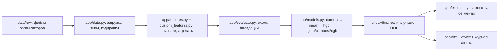

# Решение: архитектура и логика

<!-- Технические детали для README и вопросов жюри. -->

## Конвейер

## Агент (оркестратор)
`app/agent/orchestrator.py` выполняет полный цикл и пишет каждое решение с причиной в `runs/<run_id>/agent_log.jsonl`: выбор target и метрики, схема CV, отброшенные колонки, упавшие модели (лестница фолбэков), проверки «нет сигнала» и «подозрительно высоко», выбор ансамбля, проверка сабмита. Советник `app/agent/planner.py` предлагает следующие эксперименты (правила; LLM — по желанию, получает только агрегаты).

## Признаки
<!-- что придумали и зачем — по одной строке -->

## Модели и параметры
<!-- финальная модель, params.toml, сколько итераций -->

## Что не сработало
